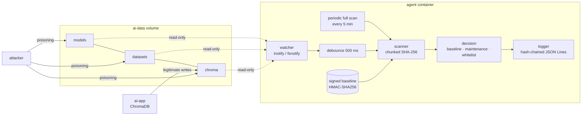

# AI Unauthorized Change Detector

[](https://github.com/Wicknaer/ai-unauthorized-change-detector/actions/workflows/ci.yml)

**Unauthorized change detection for AI file systems** — a background agent (`fimagent`) that
watches model weights, vector databases and training datasets, detects unauthorized changes in
under a second and logs them as high-priority, tamper-evident alerts.

It addresses **OWASP Top 10 for LLM Applications 2026 – LLM05: Data and Model Poisoning** at the
file-system level: an attacker who gets write access to the files an LLM / RAG application
depends on can backdoor the model, poison the training data or inject misleading documents into
the vector store. The agent does not block writes; it makes sure none of them go unnoticed.

> Computer Engineering Design project — Fırat University, Department of Computer Engineering.
> Team **Makine Dairesi** (project no. 30).

## What it monitors

| Asset | Example files | Alert on change |
|---|---|---|
| Model weights | `.safetensors`, `.gguf`, `.pt`, `.bin` | CRITICAL |
| Agent config and baseline | `config.yaml`, `baseline.json` | CRITICAL |
| Vector database (ChromaDB) | `chroma.sqlite3`, HNSW index files | HIGH |
| Training / fine-tuning data | `.csv`, `.jsonl`, `.parquet` | HIGH |

Permission/ownership changes and new files are MEDIUM. Changes during maintenance mode and
changes by whitelisted processes (identified with fanotify) are logged as INFO.

## How it works



1. A kernel event arrives for a monitored path; bursts on the same file are coalesced (500 ms).
2. When the file settles it is rehashed in 4 MB chunks and compared with the **HMAC-signed baseline**.
   Decisions rely on the hash only, so a faked mtime (`touch -r`) does not hide a change.
3. The decision engine assigns a severity from the asset type, maintenance mode and whitelist.
4. The result is written as one JSON line that carries the hash of the previous line, so a
   deleted or edited log line is detectable.
5. A **periodic full scan** feeds the same decision step and catches what kernel events miss
   (mmap writes, queue overflow, changes made while the agent was down).

The agent also protects itself: a forged baseline is rejected (CRITICAL), its own config file
is monitored, and a gap in heartbeats is reported on restart.

## Quick start (any OS, no Docker)

Requires Go 1.22+ and Python 3.

```bash
bash examples/demo/run_demo.sh
```

The demo builds the agent, creates small sample assets, takes a signed baseline, runs the
attack simulations and shows the detections:

```text
== Full scan after the attacks (exit code 1 = alerts found)
[HIGH]     detection deleted   .../datasets/imdb_train.csv        - monitored file deleted
[HIGH]     detection modified  .../datasets/imdb_train.jsonl      - content differs from baseline
[CRITICAL] detection modified  .../models/gpt2-demo.safetensors   - content differs from baseline
[CRITICAL] detection modified  .../models/tinyllama-demo.gguf     - content differs from baseline
scan complete: 6 files, 8.4 MiB, 5 change(s), 5 alert(s), 7ms

== T-11: forge the baseline (signature check must fail)
[CRITICAL] integrity baseline_signature_invalid .../state/baseline.json
fimagent: invalid baseline signature

== T-15: delete a line from the alert log (chain must break)
log chain BROKEN after 2 valid line(s): line 3: prev_hash does not match the previous line
```

For real-time detection, start the agent and change a file in another terminal:

```bash
examples/demo/bin/fimagent watch -config examples/demo/config.yaml
```

## Docker lab

The isolated test environment from the project plan: four containers on an internal network
with no internet access.

```bash
docker compose -f docker/docker-compose.yml up -d --build      # first run downloads ~6 GB of test data
docker compose -f docker/docker-compose.yml exec attacker bash /simulations/attacks.sh t01
docker compose -f docker/docker-compose.yml logs --tail 5 agent
```

| Service | Role |
|---|---|
| `data-init` | One-shot loader: GPT-2, TinyLlama GGUF, synthetic 100 MB–4 GB files, IMDB, SQuAD → ChromaDB |
| `ai-app` | ChromaDB server, the legitimate writer |
| `agent` | `fimagent`; `/data` mounted **read-only**, private `agent-state` volume, `cap_drop: ALL` + `SYS_ADMIN` |
| `attacker` | Compromised process with write access to `/data` |

See [docs/installation.md](docs/installation.md) for details and
[docs/isolation_check.sh](docs/isolation_check.sh) for the isolation checks.

## CLI

```text
fimagent init          create the HMAC key and the first signed baseline
fimagent watch         run the agent (real-time events + periodic full scan)
fimagent scan          one-shot full scan against the baseline (exit code 1 if alerts)
fimagent maintenance   on|off|status - suppress alerts during authorized updates; "off" renews the baseline
fimagent rebaseline    renew the signed baseline (-reason required)
fimagent report        list or export records (-since 24h -min HIGH -format table|csv|json -out file)
fimagent verify-log    verify the hash chain of the alert log
fimagent status        show baseline, maintenance and heartbeat state
```

Authorized model update (UC-03):

```bash
fimagent maintenance on  -by ml-engineer -reason "fine-tuned v2"
cp new-model.safetensors /data/models/            # no alerts while maintenance is on
fimagent maintenance off -by ml-engineer          # baseline renewed and logged
```

## Configuration

```yaml
agent:
  state_dir: /var/lib/fimagent   # baseline, HMAC key, maintenance flag
  scan_interval: 5m
  debounce: 500ms
watch:
  - name: models
    path: /data/models
    asset: model                 # model | config | vectordb | dataset
    patterns: ["*.safetensors", "*.gguf"]
exclude: ["*-journal", "*-wal", "*-shm"]   # SQLite temp files written by ChromaDB
```

Full example: [config/agent.docker.yaml](config/agent.docker.yaml). Unknown keys, nested
watch roots, a state directory inside a monitored directory and similar mistakes are rejected
at start-up.

## Repository layout

| Path | Contents |
|---|---|
| `agent/` | Go source of the agent: `config`, `hasher`, `baseline`, `scanner`, `watcher`, `decision`, `logger`, `state`, `report`, `agent` packages and `cmd/fimagent` |
| `simulations/` | Attack scripts for the test scenarios (T-01 … T-08) |
| `docker/` | Compose file and Dockerfiles for the lab |
| `data/` | Scripts that download and prepare the test data |
| `config/` | Agent configuration for the lab |
| `examples/demo/` | Self-contained local demo |
| `docs/` | Installation, log schema, baseline format, exclusions, requirements status |

## Status

Implemented and covered by tests: configuration, chunked hashing, signed baseline, real-time
watcher with debounce and new-directory handling, periodic scan, decision engine with
severities and maintenance mode, hash-chained JSON Lines log, reporting/CSV export, heartbeat
and monitoring-gap detection.

Process attribution with **fanotify** (PID, command, executable, user) identifies the writer of
every change, so the ChromaDB server's own writes are INFO while a direct `sqlite3` write is
HIGH ([design](docs/design/process_attribution.md)).

Next: latency/accuracy measurement in the lab (p50/p95, TP/FP/FN); webhook alerts; log rotation.

Requirement-by-requirement progress: [docs/requirements_status.md](docs/requirements_status.md).

## Team

| Name | Role |
|---|---|
| Bahadır Şahin | Project lead, security architecture, development |
| Hüseyin Emre Bülbül | AI infrastructure, documentation, development |
| Barış Özküçük | Systems engineering, virtualization, development |

## References

1. OWASP GenAI Security Project (2026). *OWASP Top 10 for LLM Applications 2026 — LLM05: Data and Model Poisoning.*
2. Linux man-pages project. *inotify(7)*, *fanotify(7)*.
3. Maas, A. L. et al. (2011). *Learning Word Vectors for Sentiment Analysis* (IMDB dataset).
4. Rajpurkar, P. et al. (2016). *SQuAD: 100,000+ Questions for Machine Comprehension of Text.*
