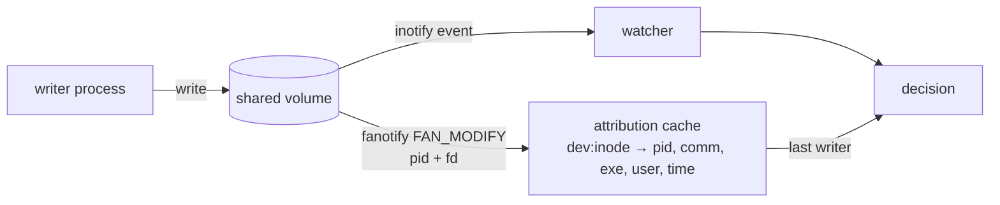

# Process attribution

inotify (used through fsnotify for the real-time events) tells *that* a file changed, not
*who* changed it. Telling the legitimate ChromaDB server apart from an attacker writing the
same `chroma.sqlite3` needs the writer's PID (FR-10, FR-11), which only fanotify provides.

## How it works

1. `attribution.Open` calls `fanotify_init(FAN_CLASS_NOTIF)` and marks every watch root with
   `FAN_MARK_FILESYSTEM` for `FAN_MODIFY | FAN_CLOSE_WRITE`. A mount mark would only see writes
   made through the agent's own (read-only) mount; the attacker and ChromaDB write through
   theirs. If the file system refuses a filesystem mark, a mount mark is used and reported in
   the `agent_start` record (`attribution: fanotify/mount`).
2. For every event the agent `fstat`s the event's file descriptor and stores the writer under
   the file's **device + inode**. Keying on the inode makes it independent of where each
   container mounts the volume (`/data` in the attacker, `/data` read-only in the agent).
3. The writer's details come from `/proc/<pid>/{comm,exe,status}`; with `pid: host` the agent
   sees processes of every container. The agent ignores its own PID.
4. When the decision step runs for a change, it asks for the last writer of that file.

## When a write is credited

A recorded write only explains the file if the file was not modified after it:
`mtime <= write time + 2 s`. A write through `mmap` produces no fanotify event but moves the
mtime later, so it is **not** credited to an earlier ChromaDB write and still raises an alert
(T-09). Deletions and renames carry no PID in this mode and are always unattributed.

## Accepted changes

ChromaDB keeps writing its database, so the file drifts away from the baseline on purpose.
Renewing the baseline from the agent would break FR-03 (baseline only renewed from the CLI),
and comparing against the old baseline would re-raise every legitimate write in the next
periodic scan. Instead, a whitelisted change is written to `accepted.json` in the agent-state
volume:

* signed with the same HMAC key as the baseline and bound to the baseline's signature;
* the scanner compares files with **baseline + accepted changes**;
* a forged or edited `accepted.json` is a CRITICAL `accepted_tampered` record and the agent
  refuses to start with it; a deleted one only makes earlier legitimate writes alert again;
* `fimagent rebaseline` and `maintenance off` remove it, because the new baseline already
  contains those changes.

## Limits

| Limit | Effect | Mitigation |
|---|---|---|
| Short-lived writers can exit before `/proc` is read | Only the PID is known, `comm` is empty | Such a write is never whitelisted, so it still alerts |
| SQLite WAL: ChromaDB may checkpoint an attacker's WAL frames into the main file | The final write to `chroma.sqlite3` is ChromaDB's | Measured in the lab (week 7); see the report |
| Requires `CAP_SYS_ADMIN` | Without it attribution is disabled | Logged as `attribution_unavailable`; detection still works, nothing is whitelisted |
| fanotify is Linux only | No attribution on Windows/macOS | Development only; the lab runs on Linux |
